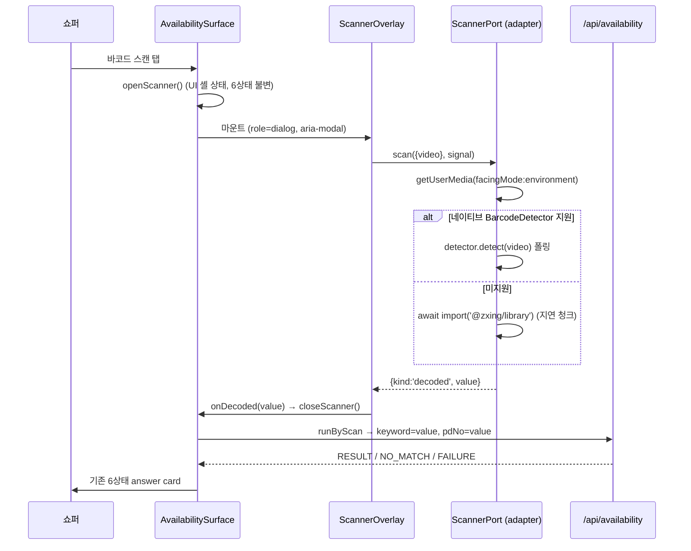

# 바코드 스캔 진입 설계 (HANDOFF 🟢 슬라이스 2)

> 상태: **owner 승인 완료(2026-07-25)** — 아래 §0의 3개 질의 확정. 구현 플랜 = [`../plans/2026-07-25-barcode-scan.md`](../plans/2026-07-25-barcode-scan.md).
> 앱-소유 결정은 [`../../notes/open-questions.md` §B30](../../notes/open-questions.md)에 등재. 제품 철학 정본은 Bible(read-only).

## 0. 승인된 결정 (owner, 2026-07-25)

| # | 질문 | 확정 |
|---|---|---|
| D1 | Bible이 침묵하는 스캔 카피 4종(권한 거부·디코드 실패 힌트·미지원 기기·스캔 진입 Empty) | **앱 정직 초안 + Bible 비준 대기** (restock 카피 선례와 동일 경로) |
| D2 | 검증 범위 | **DEV mock `ScannerPort` + 유닛/E2E**. 실기기 카메라(iOS/Android)는 §B9로 미검증 유지 |
| D3 | 물리 바코드 ≠ pdNo 가능성 | **디코드 문자열을 그대로 조회**(keyword=pdNo=값) + 매칭 실패 시 **정직한 Empty + 텍스트 검색 폴백**. 추측 변환층(EAN 체크섬/prefix 파싱) 금지 |

이전 세션 owner 확정(이미 유효): 스캔값 = **품번(pdNo) 전제** · 조회는 **기존 `/api/availability` 재사용**(신규 백엔드 없음) · 디코더 = **네이티브 `BarcodeDetector` + 번들 `@zxing/library` 폴백**(외부 CDN 금지) · `ScannerPort`는 `GeolocationPort` 심 패턴 미러링.

## 1. 목표 / 비목표

**목표**: 검색바의 기존 `바코드 스캔` 버튼(현재 dead stub)을 살려서, 카메라로 바코드를 디코드 → 그 값으로 기존 재고 조회 파이프라인을 태워 **동일한 6상태 answer card**로 수렴시킨다.

**비목표(이번 슬라이스 밖)**:
- AI 확신도 티어링·이미지 인식·"이거 맞나요?" 카메라 판별 — Bible이 **금지**(`Experience/in-store-navigation.md:219`, `Engineering/in-store-navigation.md:140`). 카메라는 **바코드 디코드 전용**.
- 매대 라벨(shelf label) OCR — Bible이 스캔 대상으로 언급하나 디코딩 규격 미정의. 이번 슬라이스는 **상품 포장 바코드만**(정정 2026-07-26 — DataMatrix 전용, §3.2).
- UI 폴리싱(슬라이스 3) — 오버레이는 기능·a11y 완성, CSS는 최소.
- 실기기 필드 검증(§B9) — 물리 카메라 없음.

## 2. Bible 준수 매트릭스 (정찰 근거)

| Bible 규정 | 출처 | 이 설계의 대응 |
|---|---|---|
| 진입 3경로(타이핑·스캔·최근검색)가 **모두 같은 answer card로 수렴** | `Interface/availability-check.md:64-70` | 스캔도 `SUBMIT → loading → 6상태`. 스캔 전용 결과 화면 없음 |
| `Any answer state --(re-search / scan)--> Loading` | `Interface:118` | 디코드 성공 즉시 `SUBMIT` 디스패치 → loading |
| 스캔 버튼 레이블 `바코드 스캔`(아이콘 단독 금지, ≥44pt) | `Interface:420` | 기존 `SCAN_BUTTON_LABEL` 상수 불변 재사용 |
| placeholder `상품명 또는 바코드 스캔` | `Interface:135` | 불변 |
| search/scan bar는 답변 상태에서 **L4로 강등** | `Interface:44,55` | 기존 `search-bar--demoted` 유지 |
| **권한 거부 → 텍스트 검색 폴백** / **디코드 실패 → 카메라 유지 + 재입력 힌트** | `Engineering:97-98` | §5 상태표대로 구현(카메라 자동 종료 없음) |
| `barcode scan is always reachable` | `AI/availability-check.md:55` | 미지원 기기에서도 버튼을 **숨기지 않고** 정직한 문구로 응답 |
| fallback-first: 리터럴 검색·스캔이 AI보다 **먼저** | `AI:47,49` | 이번 슬라이스가 그 순서를 지킴 |
| Anti-goal 4(첫 답변 앞 계정/온보딩 금지) | `INDEX §5` | 카메라 권한은 **스캔을 탭했을 때만** 요청. 프라이밍 화면·튜토리얼 없음 |
| Anti-goal 5(모호한 종료 금지) | `INDEX §5` | 권한 거부·디코드 실패·스캔 Empty 전부 **구체적 다음 단계**(상품명 검색)로 종료 |
| Anti-goal 3(연출된 확신 금지) | `INDEX §5` | 부분 디코드/추정 매핑 없음. D3의 "정직한 실패" |
| D082(QR은 진입 수단 아님) | `Interface:343-347` | **매장 컨텍스트** 결정이며 상품 바코드와 무관. 그래도 심볼로지에서 QR 제외(§4) |
| 금지 카피 형태(비난 구문 `권한이 없습니다`, 기술용어) | `shared/ux-writing-korean.md:136-137` | §6 초안이 결과 언어만 사용 |

**Bible 침묵(=앱 초안, D1)**: 뷰파인더 화면의 존재·레이아웃, 권한 거부 카피, 디코드 실패 힌트 문구·타이밍, 스캔 진입 Empty 카피, 스캔 성공 피드백, 최근 검색 기록 여부.

## 3. 아키텍처



**심(seam) 배치** — `GeolocationPort` 패턴 정확히 미러링:

| 역할 | 파일 |
|---|---|
| 포트 | `src/domain/ports.ts` — `ScannerPort`, `ScanOutcome`, `ScanTarget` |
| 실 어댑터 | `src/adapters/barcode/browserScanner.ts` — `createBrowserScanner(deps)` |
| mock | `src/adapters/mock/scanner.ts` — `createMockScanner(value?)` |
| PROD/mock 스위치 | `src/adapters/composition.ts` — `createScanner()` |
| 루트 배선 | `src/ui/AvailabilitySurface.tsx` 모듈 스코프 const → 오버레이에 prop 주입 |

### 3.1 포트 계약

```ts
export type ScanOutcome =
  | { kind: 'decoded'; value: string }
  | { kind: 'permissionDenied' }
  | { kind: 'unsupported' }
  | { kind: 'cancelled' }
  | { kind: 'failed' };

export interface ScanTarget { video: HTMLVideoElement }

export interface ScannerPort {
  scan(target: ScanTarget, signal: AbortSignal): Promise<ScanOutcome>;
}
```

- **절대 throw하지 않는다** — 모든 실패가 variant로 표현(`browserGeolocation`이 전 실패경로 `[]`를 반환하는 규율과 동일). UI가 실패를 놓칠 수 없다.
- `signal.abort()` → 카메라 트랙 정지 + 폴링/리더 정리 → `{kind:'cancelled'}`. **카메라를 켠 채 남기지 않는다.**
- 디코드 실패는 outcome이 아니라 **무한 대기**(Bible: 카메라 유지). 오버레이가 10초 후 힌트만 표시하고 스캔은 계속된다.

### 3.2 디코더 전략

1. `'BarcodeDetector' in globalThis`이고 `await BarcodeDetector.getSupportedFormats()`가 `data_matrix`를 포함할 때만 → 네이티브 사용(주로 Android Chrome), `detect(video)` 폴링 200ms. 이 확인 없이 네이티브를 그냥 쓰면 DataMatrix 미지원 플랫폼에서 `detect()`가 영원히 아무것도 찾지 못한 채 카메라만 켜진 상태로 멈춘다(무음 행) — 그래서 지원 프로브가 필수다.
2. 네이티브가 없거나 `data_matrix`를 지원하지 않으면 → `await import('@zxing/library/esm/browser/BrowserDatamatrixCodeReader')`(**딥 임포트**로 지연 청크 분리, 초기 PWA 번들 불변, 외부 CDN 아님). `@zxing/library`는 `sideEffects` 미선언이라 배럴 임포트로는 트리셰이킹이 안 돼, 전용 리더를 딥 경로로 직접 끌어와야 다른 zxing 디코더가 청크에 섞이지 않는다. iOS Safari 등 대부분의 경로.
3. 둘 다 불가 → `{kind:'unsupported'}`.

**심볼로지**: `data_matrix` 전용(`SCAN_FORMATS = ['data_matrix']`).

> **정정(2026-07-26)**: 최초 결정(1D 상품 바코드 7종 — `ean_13`·`ean_8`·`upc_a`·`upc_e`·`code_128`·`code_39`·`itf`, QR/DataMatrix 제외)은 **data-owner가 포장 심볼로지를 확인해주기 전**의 결정이었다. data-owner 확인(§B30-7, `open-questions.md`): DAISO 상품 포장은 2D DataMatrix를 쓰고 페이로드가 `pdNo` 그 자체다. 같은 포장의 1D 바코드는 `pdNo`가 아닌 별개 번호(EAN/UPC)라, 그것을 디코드하면 **엉뚱한 상품으로 조회**된다 — 배타성(1D 전종·QR 제외)은 스코프 축소가 아니라 정확성 요구다.

### 3.3 조회 경로 — 신규 백엔드 없음

`runByScan(store, value, dispatch, runner)`:
1. `dispatch({type:'SUBMIT', query: value, origin:'scan'})` → loading
2. `runner(store, value, value)` → 기존 `/api/availability`가 `keyword=value`(서버 필수) + `pdNo=value`(B29 pdNo-identity)로 조회
3. 기존 런 토큰 + `isCurrentRun` 가드 동일 적용 → 이벤트 디스패치

**검색-우선 `runQuery`를 태우지 않는다**: 바코드는 이미 정확 식별자이므로 후보 리스트가 무의미하고, `/api/search`의 M2 온라인전용 제외 필터가 정확 매칭을 떨어뜨릴 수 있다. 왕복도 1회 줄어든다.

**최근 검색 미기록(앱 결정)**: 바코드 숫자열은 recognition-over-recall 가치가 없고 목록을 오염시킨다. `recordSearch` 호출 안 함.

## 4. 상태 모델 — 6상태 불변

**뷰파인더는 UiState가 아니다.** `sheetOpen`과 같은 **UI 셸 상태** `scannerOpen`(zustand)으로 모델링한다. 도메인 상태 머신의 6상태 집합·의미·판정 로직은 **불변**.

도메인에 추가되는 유일한 것은 **출처(provenance)** 한 필드:
- `StoreEvent.SUBMIT`에 `origin?: 'scan'`
- `UiState.loading` / `UiState.empty`에 `origin?: 'scan'`
- reducer: `SUBMIT` → loading에 origin 전달, `NO_MATCH` → `state.state==='loading' ? state.origin : undefined`로 스레딩(기존 `RESULT`/`FAILURE`가 query를 스레딩하는 방식과 동일 패턴, B15 선례)

이 필드는 **카피 선택에만** 쓰이고 상태 판정·재고 해석에는 관여하지 않는다.

## 5. 실패/예외 시나리오 (전부 구체적 다음 단계로 종료)

| 시나리오 | 동작 | 카피 |
|---|---|---|
| 권한 거부(`NotAllowedError`) | 오버레이 유지, 카메라 없음, 검색바로 폴백 안내 | `SCAN_PERMISSION_DENIED` |
| 브라우저 미지원(getUserMedia API 부재 · 디코더 로드 불가) | 동일 | `SCAN_UNSUPPORTED` |
| 카메라 하드웨어 오류(`NotReadableError`·`NotFoundError` 등) | 동일 | **`SCAN_FAILED`** (기술용어 노출 금지) |
| 디코드 안 됨 | **카메라 유지, 계속 스캔**, 10초 후 힌트 표시 | `SCAN_HINT` |
| 닫기 / Escape | abort → 트랙 정지 → 오버레이 해제, 포커스 스캔 버튼 복귀 | `닫기`(기존 Bible 상수 재사용) |
| 디코드 성공 → 카탈로그 미매칭 | 정직한 Empty(스캔 전용 카피) | `scanEmptyBody(value)` |
| 디코드 성공 → 네트워크 실패 | 기존 error/partial 경로 그대로 | 기존 카피 |
| 오버레이 열린 채 매장 변경 | 스캔 취소 후 시트 열림 | — |

**오프라인/복구**: 스캔 자체는 로컬 연산이라 오프라인에서도 디코드된다. 조회는 기존 `query-cache`(2초 타임아웃 → 캐시 폴백) 경로를 그대로 탄다.

> **정직성 정정(2026-07-25, Task 1 리뷰 반영)**: 카메라가 **일시적으로** 사용 불가한 상황(다른 앱이 점유 `NotReadableError`, 장치 없음 `NotFoundError`)을 `unsupported`로 접으면 "이 브라우저는 스캔을 못 한다"는 **영구적 사실을 날조**하게 된다(Anti-goal 3). 따라서 `unsupported`는 **getUserMedia API 자체가 없거나 디코더를 못 불러온 경우**로 좁히고, 그 외 카메라 획득 실패는 `failed`로 분류한다. D1 승인 범위(앱이 스캔 실패 카피·분류를 정직하게 초안) 안의 결정.

## 6. 카피 초안 (앱 소유 · Bible 비준 대기, D1)

```ts
// 앱 초안 — Bible 침묵 구간. 비준 시 Bible 문자열로 교체.
export const SCAN_PERMISSION_DENIED = '카메라를 사용할 수 없어요. 상품명으로 검색해 보세요.';
export const SCAN_UNSUPPORTED = '이 브라우저에서는 바코드 스캔을 쓸 수 없어요. 상품명으로 검색해 보세요.';
export const SCAN_FAILED = '지금은 스캔할 수 없어요. 상품명으로 검색해 보세요.';
export const SCAN_HINT = '바코드가 잘 안 읽히면 상품명으로 검색해 보세요.';
export function scanEmptyBody(value: string): string {
  return `'${value}' 바코드로 등록된 상품을 찾지 못했어요. 상품명으로 검색해 보세요.`;
}
```

> **`SCAN_FAILED` 문구 정정(2026-07-26, 최종 리뷰 반영)**: 초안은 `'바코드를 읽지 못했어요. …'`였으나, 이 상수는 디코더 오류뿐 아니라 **카메라 획득 실패**(§5 표의 `NotReadableError`·`NotFoundError` 등)에서도 뜬다. 카메라를 열지도 못한 상황에서 "바코드를 읽지 못했다"고 말하면 **하지 않은 판독을 날조**한다(Anti-goal 3). 두 원인 모두에 정직한 `'지금은 스캔할 수 없어요. …'`로 교체하고, `지금은`으로 **일시성**을 유지한다(§5 정직성 정정과 같은 논리). 나머지 3종은 초안 그대로 — 여전히 Bible 비준 대기(B30-4).

재사용(신규 아님): `SCAN_BUTTON_LABEL`(버튼·다이얼로그 제목), `STORE_SELECT_CLOSE`(`닫기`).

규칙 준수: 비난 구문(`권한이 없습니다`) 없음 · 기술용어(`NotAllowedError`, `카메라 초기화 실패`) 없음 · 모든 문장이 **다음 행동**으로 끝남(Anti-goal 5) · 어미는 기존 카피군의 `~어요` 유지.

## 7. 접근성

- 오버레이 = `role="dialog" aria-modal="true"`, `aria-labelledby`로 `바코드 스캔` 제목 연결 (`StoreSelectionSheet` 선례 그대로).
- 열릴 때 닫기 버튼에 포커스, 닫힐 때 **스캔 버튼으로 포커스 복귀**(기존 `changeStoreRef` 패턴).
- Escape로 해제(IME 조합 중 무시 — 기존 시트와 동일).
- 배경 `inert` 처리(기존 `backgroundInert` 재사용).
- 상태 문구는 `LiveRegion`이 아니라 다이얼로그 내부 텍스트로 노출(다이얼로그가 이미 포커스를 보유).
- `<video>`는 `aria-hidden`(장식적 프리뷰 — 정보는 텍스트로 제공), `playsInline muted autoPlay`.

## 8. 검증 (D2)

- **유닛**: 어댑터(네이티브 경로·zxing 폴백 경로·권한 거부·미지원·abort 시 트랙 정지), composition 스위치(PROD/DEV), 오버레이 컴포넌트(a11y·Escape·포커스·아웃컴별 카피), 카피 상수 verbatim, reducer origin 스레딩, `runByScan` 토큰/가드.
- **E2E(dev 프로젝트)**: DEV mock 스캐너가 고정 pdNo를 반환 → 스캔 버튼 → 오버레이 → answer card까지 상호작용 검증. PROD preview 프로젝트는 카메라 미사용이라 변경 없음.
- **번들**: `npm run build` 후 zxing이 **별도 청크**로 분리됐는지 확인(초기 청크 증가 없음).
- **게이트**: vitest + tsc + biome + playwright 전부 GREEN, 시크릿 부재.

## 9. 레거시/파리티 검증 포인트

이 앱은 레거시 POS 이식이 아니라 신규 PWA이므로 파리티 대상은 **Bible 규범**이다. 회귀 금지 항목:
1. 6상태 집합·의미·`mapStoreObservation` 판정 로직 — **코드 변경 없음**
2. Bible verbatim 카피 문자열 — **변경 없음**(추가만)
3. `/api/availability`·`/api/search` 서버 계약 — **변경 없음**
4. `RawStoreObservation` 화이트리스트 — **변경 없음**
5. 타이핑·최근검색 진입 경로 동작 — **변경 없음**(기존 테스트가 회귀 감시)

## 10. 잔여 리스크 (기록만, 이번 슬라이스에서 해소 불가)

- **R1(중) → ✅ 2026-07-26 해소(data-owner 확인: 물리 바코드 = `pdNo`)**: 스캔 값이 곧 `pdNo`이므로 D3의 verbatim 조회가 그대로 올바른 경로다(코드 변경 없음). 근거는 data-owner 진술이며 우리 관측이 아니다 — 계약에 바코드 필드가 없어 기계 검증은 불가(아래 프로브). **남는 검증은 심볼로지 커버리지가 아니라 실기기 디코드 품질**(§B9): DataMatrix 전용 정정(§3.2, 2026-07-26) 이후 심볼로지 자체는 더 이상 변수가 아니다 — 남는 것은 매장 조명·포커스 조건에서 작고 조밀한 DataMatrix를 카메라가 실제로 읽어내는지다. 어긋나면 정직한 Empty로 끝나며 교정은 어댑터 심 뒤에서만.
  - **읽기전용 프로브 근거(2026-07-25, 5요청 GET·무인증·무쓰기)**: SearchGoods 응답 doc **74필드 전수 확인 결과 바코드성 필드 0건**(`barCd·ean·jan·upc·gtin·stdPdNo` 전부 부재, 12~14자리 숫자 값도 0건). 요청 파라미터에도 바코드 자리 없음. 하위 재고·위치 엔드포인트의 **유일한 상품 키는 `pdNo`**. → "응답에서 EAN을 얻어 대조"하는 **역방향 검증 경로가 계약에 존재하지 않는다.**
  - 같은 프로브에서 `searchTerm=19987`·`1031166`(알려진 pdNo) → **정확 매칭 doc 반환 확인**(오너 전제가 맞을 경우 경로 성립). 임의 생성 13자리(`8801234567890`) → 0 doc·에러 없음 = **정직한 무매칭 형상**(단, 실제 다이소 상품 바코드가 아니므로 "EAN 미색인"의 증거는 **아님**).
  - **갭을 닫는 최소 행동(owner 1행동)**: 실제 매장 상품 포장의 바코드 숫자 1개 → 1요청으로 색인 여부·자릿수 판정 가능. 그 전까지 스캔 값 해석은 **어댑터 심 뒤 격리**(CLAUDE.md §3 data-owner 경험적 사실).
- **R2(중)**: iOS Safari의 `getUserMedia`는 **HTTPS(또는 localhost)** 필수. 현재 로컬 개발은 http://localhost라 동작하나, gpu01 배포 시 HTTPS 필수 — 배포 런북에 반영 필요(ToS 게이트 뒤).
- **R3(하)**: zxing 폴백 청크(수백 KB)가 iOS 최초 스캔 시 지연을 만든다. 지연 import라 초기 로드는 무영향.
- **R4(하)**: 카피 4종이 Bible 비준 전 상태 — 비준 시 문자열 교체(테스트가 verbatim으로 잠가둠).
