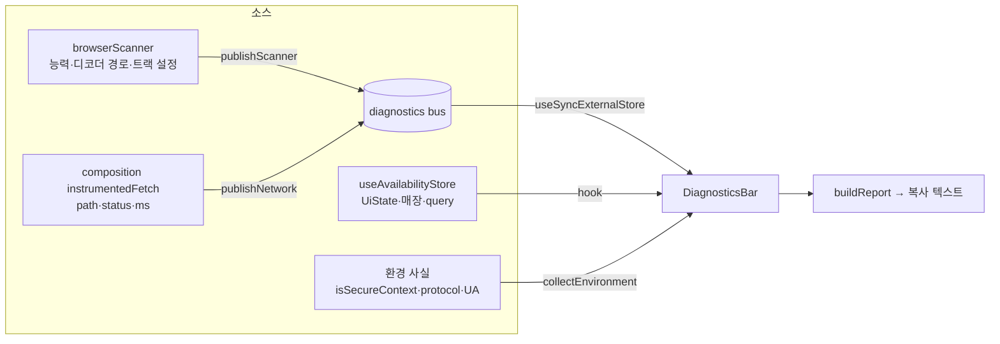

# 온스크린 진단 패널 설계 (테스트 계측)

> 상태: **owner 승인 완료(2026-07-27)** — §0의 4개 결정 확정.
> 앱-소유 결정은 [`../../notes/open-questions.md` §B31](../../notes/open-questions.md)에 등재 예정. 제품 철학 정본은 Bible(read-only)이며, 이 패널은 **쇼퍼 대상 제품 표면이 아니라 개발·테스트 계측**이므로 Bible 카피 규칙의 적용 대상이 아니다(§9).

## 0. 승인된 결정 (owner, 2026-07-27)

| # | 질문 | 확정 |
|---|---|---|
| D1 | 패널 활성 조건 | **`?debug=1` 런타임 스위치**. 빌드 모드가 아니라 URL 파라미터. 배포본에도 코드는 존재하되 lazy 청크로 분리되어 미활성 시 다운로드되지 않음 |
| D2 | 정보 범위 | **스캐너 진단 + 앱 상태 + 복사 버튼** |
| D3 | 표시 형태 | **하단 접이식 바**. 접힘 = 한 줄 실시간 요약, 펼침 = 전체 항목 |
| D4 | `getUserMedia` 해상도 제약 수정(§8) | **이번 스코프에 포함하되 패널을 먼저 구현**. 순서를 지켜야 "640×480 → 요청 해상도" 변화가 측정된 사실로 남는다 |

### D1의 근거 — DEV 게이팅이 왜 무효인가

`import.meta.env.DEV`로 게이팅하면 패널은 **진단 대상이 존재하지 않는 빌드에서만** 뜬다:

- `npm run dev`(DEV) → `composition.ts:38`이 `createMockScanner()`를 주입. 카메라·디코더가 아예 없음.
- `npm run dev:live`(`package.json:7` = `npm run build && node scripts/dev-proxy.mjs`) → **PROD 빌드**. 실제 `createBrowserScanner()`가 붙지만 `DEV`는 false.
- 폰 실기기(§B9) → PROD 빌드 + **콘솔 접근 수단 없음**. 진단이 가장 필요한 환경.

기존 `?scenario=` 하니스(`AvailabilitySurface.tsx:263-266`)가 URL 파라미터 선례이나, 그쪽은 mock 전용이라 `DEV` 게이팅이 타당했다. 이 패널은 반대 요구를 가진다.

## 1. 목표 / 비목표

**목표**: `?debug=1`로 켜면 화면 하단에 진단 바가 뜨고, Chrome 콘솔 없이 **환경·스캐너·앱 상태·네트워크**의 현재 사실을 읽을 수 있으며, 그 전체를 텍스트로 복사해 기록으로 남길 수 있다.

**비목표(이번 스코프 밖)**:
- 시간순 이벤트 타임라인 로그(D2에서 기각) — 링버퍼·구독 관리 비용 대비 이득이 불확실.
- 원격 로그 전송·텔레메트리 — 저장소는 ToS 게이트 전까지 로컬 전용이며, 관측값을 외부로 보내지 않는다.
- 쇼퍼 대상 UI·카피 변경 — 이 패널은 쇼퍼에게 도달하지 않는다.
- 스캐너 UI 폴리싱(HANDOFF 슬라이스 3) — 별건.

## 2. 아키텍처

### 2.1 대안 비교

| 안 | 방식 | 판단 |
|---|---|---|
| **A. 진단 버스 + 스토어 직접 구독** | 어댑터가 `publish*()`로 관측 사실을 흘리고 패널이 구독. 앱 상태는 Zustand에서 직접 읽음 | **채택** |
| B. 포트 반환 타입 확장 | `ScanOutcome`에 `decoderPath`·`trackSettings` 필드 추가 | **기각** — `ScanOutcome`은 6상태 판정 입력이다. 진단 목적 필드가 도메인 계약에 섞이면 포트 순수성이 깨지고, 모든 구현체(mock 포함)가 의미 없는 필드를 채워야 한다 |
| C. 전역 `fetch`/`console` 몽키패치 | 부트스트랩에서 전역 교체 | **기각** — 프로덕션 전역을 변형하고, 테스트 격리가 불가능하며, 어댑터가 이미 제공하는 `deps.fetchImpl` 주입 지점을 무시한다 |

### 2.2 핵심 규율

1. **비활성 시 완전한 no-op.** `publishScanner`/`publishNetwork`는 첫 줄에서 `if (!enabled) return`. 적재도 구독자 통지도 없다. 일반 쇼퍼에게 메모리·CPU 비용 0.
2. **패널은 lazy 청크.** `main.tsx`에서 `lazy(() => import(...))`. 미활성 시 **네트워크로 내려오지 않는다**(zxing 폴백과 동일한 규율).
3. **앱 상태는 버스를 타지 않는다.** Zustand에 정본이 있는 값을 버스로 복제하면 두 진실이 생긴다. 패널이 `useAvailabilityStore`를 직접 구독한다.
4. **버스는 읽기 전용 관측이다.** 진단 코드가 앱 동작을 바꾸지 않는다 — 판정·상태 전이·네트워크 요청 내용에 어떤 영향도 주지 않는다.

### 2.3 데이터 흐름



## 3. 파일 구조

**신규**

| 파일 | 책임 |
|---|---|
| `src/diagnostics/enabled.ts` | `?debug=1` 판정 1회. sessionStorage 유지/해제. 스토리지 실패에도 throw 금지 |
| `src/diagnostics/bus.ts` | `publishScanner`/`publishNetwork`/`getSnapshot`/`subscribe`/`resetDiagnostics`. 비활성 시 no-op. 네트워크는 최근 5건 링버퍼 |
| `src/diagnostics/report.ts` | 순수 함수 — `collectEnvironment`, `summaryLine`, `buildReport` |
| `src/ui/components/DiagnosticsBar.tsx` | 하단 접이식 바. **default export**(lazy 요구) |
| `src/styles/diagnostics.css` | 패널 스타일. `DiagnosticsBar.tsx`에서 import → lazy 청크에 동봉(`GlassSurface.tsx:3` 선례) |

**수정**

| 파일 | 변경 |
|---|---|
| `src/adapters/barcode/browserScanner.ts` | 관측 지점 6곳에 `publishScanner` 호출. `scan()` 본문을 `runScan()`으로 추출해 종료 시 outcome 1회 발행. `ScannerDeps`에 `now?: () => number` 추가 |
| `src/adapters/composition.ts` | PROD 4개 벤더 팩토리에 `{ fetchImpl: diagnosticFetch() }` 주입 |
| `src/main.tsx` | 활성 시 `<DiagnosticsBar />`를 `<AvailabilitySurface />`의 **형제**로 lazy 렌더 |

## 4. 인터페이스

```ts
// src/diagnostics/enabled.ts
export const DEBUG_PARAM = 'debug';
export const DEBUG_STORAGE_KEY = 'daiso-finder:debug';

/**
 * 판정 + 유지. `?debug=1` → true(+저장), `?debug=0` → false(+삭제), 파라미터 없음 → 저장값.
 * 순수 함수가 아니다(스토리지에 쓴다). 그래서 `storage`를 주입받아 테스트가 실물 없이 검증한다.
 */
export function resolveDebugEnabled(search: string, storage: Storage | null): boolean;

/** 모듈 초기화 시 1회 확정된 값. 앱 수명 동안 불변. */
export function isDiagnosticsEnabled(): boolean;
```

```ts
// src/diagnostics/bus.ts
export interface TrackFacts {
  width: number | null;
  height: number | null;
  frameRate: number | null;
  facingMode: string | null;
  deviceId: string | null;
}

export interface ScannerDiagnostics {
  startedAt: number | null;          // epoch ms — null이면 스캔한 적 없음
  hasBarcodeDetector: boolean | null;
  supportedFormats: string[] | null; // null = 질의 실패 또는 API 부재(빈 배열과 구분)
  decoderPath: 'native' | 'zxing' | 'none' | null;
  decoderReadyMs: number | null;
  cameraError: string | null;        // error.name 만 (메시지·스택 금지)
  track: TrackFacts | null;
  nativePolls: number | null;        // null = 해당 없음(zxing 경로)
  outcome: ScanOutcome['kind'] | null;
}

export interface NetworkEntry {
  path: string;                      // pathname 만 (쿼리·본문 금지)
  status: number | 'error';
  ms: number;
}

export interface DiagnosticsSnapshot {
  scanner: ScannerDiagnostics;
  network: NetworkEntry[];           // 최근 NETWORK_LIMIT 건, 최신이 마지막
}

export const NETWORK_LIMIT = 5;

export function publishScanner(patch: Partial<ScannerDiagnostics>): void;
export function beginScannerRun(startedAt: number): void;   // 이전 런의 값을 초기화
export function publishNetwork(entry: NetworkEntry): void;
export function getSnapshot(): DiagnosticsSnapshot;
export function subscribe(listener: () => void): () => void;
export function resetDiagnostics(): void;                   // 테스트 전용
```

`isSecureContext`·`mediaDevices` 유무는 **`ScannerDiagnostics`에 두지 않는다** — 스캔 여부와 무관한 정적 사실이므로 `collectEnvironment()`가 단독 소유한다(두 곳에서 보고하면 값이 어긋날 때 어느 쪽이 사실인지 알 수 없다).

**`getSnapshot`의 식별자 안정성이 계약이다.** `useSyncExternalStore`는 발행이 없는 한 **같은 객체 참조**를 요구한다. 버스는 스냅샷 객체를 내부에 보관하고 **발행 시에만 새 객체로 교체**한다. 매 호출마다 새 객체를 만들면 React가 무한 렌더 루프에 빠진다.

```ts
// src/diagnostics/report.ts
export interface EnvironmentFacts {
  buildMode: 'PROD' | 'DEV';         // import.meta.env.PROD
  adapters: 'live' | 'mock';         // 같은 플래그에서 파생 — composition.ts의 분기와 동일한 사실
  protocol: string;
  host: string;
  secureContext: boolean;
  hasMediaDevices: boolean;
  userAgent: string;
}
export interface AppFacts {
  state: string;                 // UiState['state'] (+ error는 variant 포함)
  query: string | null;
  origin: string | null;         // 'scan' | null
  storeId: string | null;
  storeName: string | null;
  candidateCount: number | null;
  freshnessAgeMs: number | null;
}
export function collectEnvironment(): EnvironmentFacts;
export function summaryLine(scanner: ScannerDiagnostics, now: number): string;
export function buildReport(
  env: EnvironmentFacts,
  snapshot: DiagnosticsSnapshot,
  app: AppFacts,
  now: number,
): string;
```

`summaryLine`/`buildReport`가 순수 함수인 이유: 정직성 규칙(§5)이 여기 집중되므로 DOM 없이 직접 검증 가능해야 한다.

## 5. 정직성 경계 (구현 필수 조건)

이 저장소의 **무-날조** 원칙은 진단 표면에도 그대로 적용된다. 측정하지 않은 값을 그럴듯하게 채우면, 그 화면을 근거로 §B9 판정이 내려지므로 **틀린 결론을 생산한다**.

| 항목 | 규칙 |
|---|---|
| zxing 경로의 디코드 시도 횟수 | `decodeOnceFromStream`이 내부에서 재시도하므로 **관측 불가**. `nativePolls = null` → 화면에 `시도 횟수: 측정 불가 (zxing 내부 루프)`. 추정 숫자 금지 |
| `getSupportedFormats()` | 실패·부재는 `null`(→ `질의 실패`), 지원 없음은 `[]`(→ `없음`). 둘을 하나로 뭉개지 않는다 |
| 트랙 항목 | `getSettings()`가 주지 않은 키는 `null` → `미보고`. 기본값·추정값으로 채우지 않는다 |
| `facingMode` | 데스크탑에서는 대개 미보고. 요청값(`environment`)이 아니라 **실측 반환값**을 표시한다 |
| 카메라 오류 | `error.name`만. 메시지·스택은 벤더 정보를 흘릴 수 있어 제외 |
| 네트워크 | `pathname`·status·소요ms만. **쿼리스트링·요청/응답 본문·헤더 금지** — 프록시 로그와 동일한 규율(`scripts/dev-proxy.mjs:191` 주석) |
| 비밀값 | JWT·`x-dm-uid`·AES 키는 프록시에서만 다뤄 클라이언트에 존재하지 않는다. 패널이 접근할 대상 자체가 없으며, 새로 노출하는 경로를 만들지 않는다 |

## 6. 표시 항목

**접힘(한 줄, 실시간)** — `summaryLine()`

```
zxing · 640×480 · 12.4s · 진행 중
native · 1920×1080 · 0.8s · decoded
스캔 전
```

스캔 중 뷰파인더를 최소한으로 가리면서 지금 무엇이 벌어지는지 보이게 하는 것이 목적이다.

**펼침**

| 그룹 | 항목 |
|---|---|
| 환경 | 빌드(PROD/DEV) · 어댑터(live/mock) · 프로토콜·호스트 · `isSecureContext` · `mediaDevices` 유무 · UA |
| 스캐너 | `BarcodeDetector` 존재 · `getSupportedFormats()` **전체 목록**과 `data_matrix` 포함 여부 · 선택된 디코더 · **디코더 준비 ms**(zxing 청크 로드 시간 포함) · 카메라 오류(`error.name`) · **트랙 실측** width×height·frameRate·facingMode·deviceId · 경과 시간 · 네이티브 폴 횟수 · 마지막 outcome |
| 앱 상태 | UiState · query · origin · 매장(id·이름) · 후보 수 · 캐시 나이 |
| 네트워크 | 최근 5건: path · status · ms |

**복사**: 위 전체를 `buildReport()` 텍스트로. 클립보드 API는 secure context 전용이므로 **동일 텍스트를 읽기전용 `<textarea>`로 항상 렌더**해 http LAN 환경에서도 선택·복사가 가능하게 한다(§7).

## 7. 실패·경계 처리

| 상황 | 처리 |
|---|---|
| `sessionStorage` 접근 실패(사파리 프라이빗 등) | `resolveDebugEnabled`가 삼켜서 URL 파라미터만으로 판정. 앱 부팅을 막지 않는다 |
| 클립보드 API 부재/거부 | 복사 버튼이 실패를 **표시**하고, textarea 폴백이 이미 화면에 있으므로 경로가 끊기지 않는다 |
| 스캔 중 패널 언마운트 | 버스는 앱 수명 싱글턴이라 영향 없음. 패널의 구독 해제만 수행 |
| 진단 코드 자체의 예외 | `publish*`와 `collectEnvironment`는 throw 금지. 관측 실패는 `null`로 수렴 |
| 링버퍼 상한 | 네트워크 5건 초과 시 가장 오래된 항목 폐기. 장시간 세션에서도 메모리 상한이 고정 |
| StrictMode 이중 마운트 | 구독/해제가 idempotent해야 함 |

## 8. 동반 수정 — `getUserMedia` 해상도·초점 제약

**패널 구현 이후에 착수한다**(D4).

현재 `browserScanner.ts:81`은 `{ video: { facingMode: 'environment' } }`만 넘겨 해상도 힌트가 없다. 브라우저 기본값은 통상 640×480이며, 5~8mm DataMatrix는 모듈당 픽셀이 디코드 하한 아래로 떨어진다.

```ts
stream = await media.getUserMedia({
  video: {
    facingMode: 'environment',
    width: { ideal: 1920 },
    height: { ideal: 1080 },
  },
});
```

- **`ideal`만 사용하고 `exact`·`min`은 쓰지 않는다.** `exact`는 해당 해상도를 못 내는 기기에서 `OverconstrainedError`를 던져, 지금은 흐릿하게라도 동작할 카메라를 **완전한 실패로 바꾼다**. 데스크탑 웹캠을 기기 종류로 배제하지 않기로 한 owner 결정(2026-07-27)과 정면으로 어긋난다.
- `focusMode`는 표준 `MediaTrackConstraints`가 아니고 지원이 극히 제한적이라 **제약으로 넣지 않는다**. 대신 §6이 실측 `getSettings()`를 표시하므로, 특정 기기에서 보고된다면 그때 근거를 갖고 판단한다.
- 검증: 패널의 트랙 항목이 수정 전후로 무엇을 보고하는지 실기기에서 비교한다.

## 9. Bible 경계

이 패널은 **쇼퍼에게 도달하지 않는 개발 계측 표면**이므로 Bible의 UX 카피 규칙·6상태 모델·안티골 판정 대상이 아니다. 근거:

- 진입점이 URL 파라미터뿐이고 앱 UI 어디에도 노출이 없다.
- 앱의 판정·상태 전이·표시 카피를 **변경하지 않는다**(§2.2-4).
- 미활성 시 코드가 다운로드조차 되지 않는다.

따라서 Bible D번호를 소비하지 않고 앱 자체 기록(§B31)에 남긴다. 다만 §5의 무-날조 규율은 Bible 철학의 직접 적용이며 예외 없다.

## 10. 테스트 계획

| 대상 | 검증 |
|---|---|
| `enabled.ts` | `?debug=1`→true+저장 · `?debug=0`→false+삭제 · 파라미터 없음→저장값 · 스토리지 throw 시 파라미터만으로 판정하고 예외 전파 없음 |
| `bus.ts` | 비활성 시 발행이 스냅샷을 바꾸지 않음 · 활성 시 patch 병합 · **발행이 없으면 `getSnapshot()`이 동일 참조 반환** · 링버퍼 상한 5 · 구독 해제 후 미통지 · `beginScannerRun`이 이전 런 값을 초기화 |
| `report.ts` | `nativePolls: null` → `측정 불가` 문구 · `supportedFormats: null`(질의 실패) 과 `[]`(지원 없음)이 **다른 문자열** · 트랙 미보고 키가 `미보고` · 보고서에 쿼리스트링·본문이 포함되지 않음 |
| `DiagnosticsBar.tsx` | 접힘 요약 렌더 · 펼침 토글(`aria-expanded`) · textarea에 보고서 텍스트 존재 · 스토어 상태 변화가 반영됨 |
| `browserScanner.ts` | 네이티브 경로가 `decoderPath: 'native'`와 폴 횟수를 발행 · zxing 경로가 `'zxing'`과 `nativePolls: null` 발행 · `getUserMedia` 실패 시 `cameraError`에 `error.name` 발행 · **기존 `ScanOutcome` 동작이 전부 불변**(회귀 테스트 유지) |
| `composition.ts` | PROD 팩토리에 `fetchImpl`이 주입됨 · 계측 fetch가 status·ms를 발행하고 **응답을 변형하지 않음** · 실패 시 `'error'` 발행 후 **예외를 그대로 재던짐** |
| E2E | `?debug=1`이면 바가 보이고, 없으면 DOM에 없음 |
| §8 | 제약 객체에 `ideal`이 있고 `exact`/`min`이 없음 |

## 11. 미해결·후속

- 실기기에서 이 패널로 얻은 관측은 §B9(실기기 검증)와 §B30(스캔 결정)에 되먹인다.
- 패널이 보고한 트랙 해상도가 §8 수정 후에도 낮게 유지되는 기기가 있다면, 그때 크롭·`applyConstraints` 재시도를 별도 스코프로 검토한다. **지금 추측으로 구현하지 않는다.**
